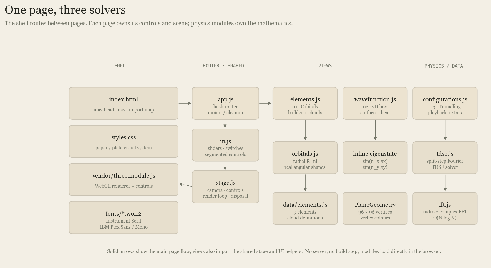
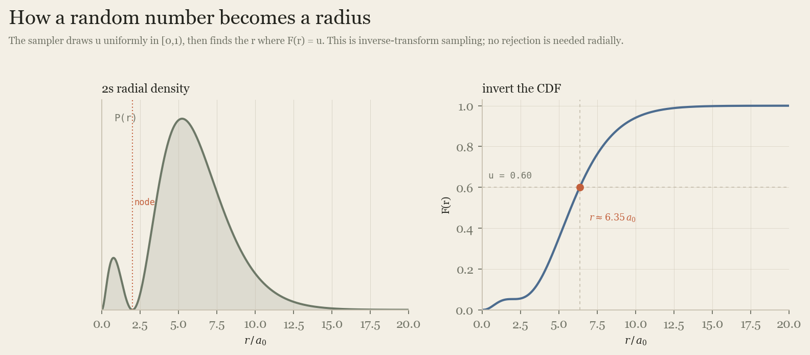
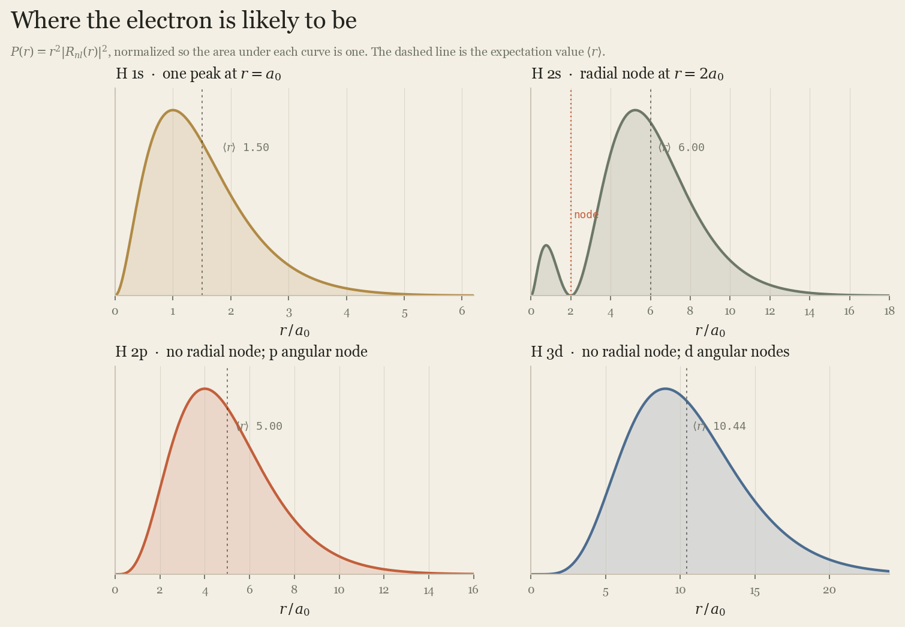
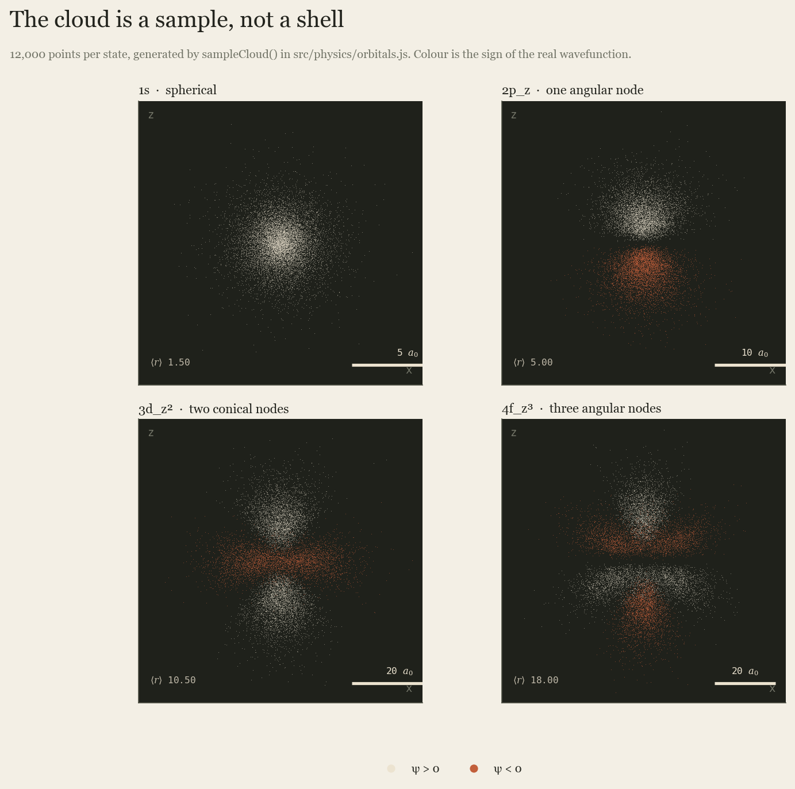
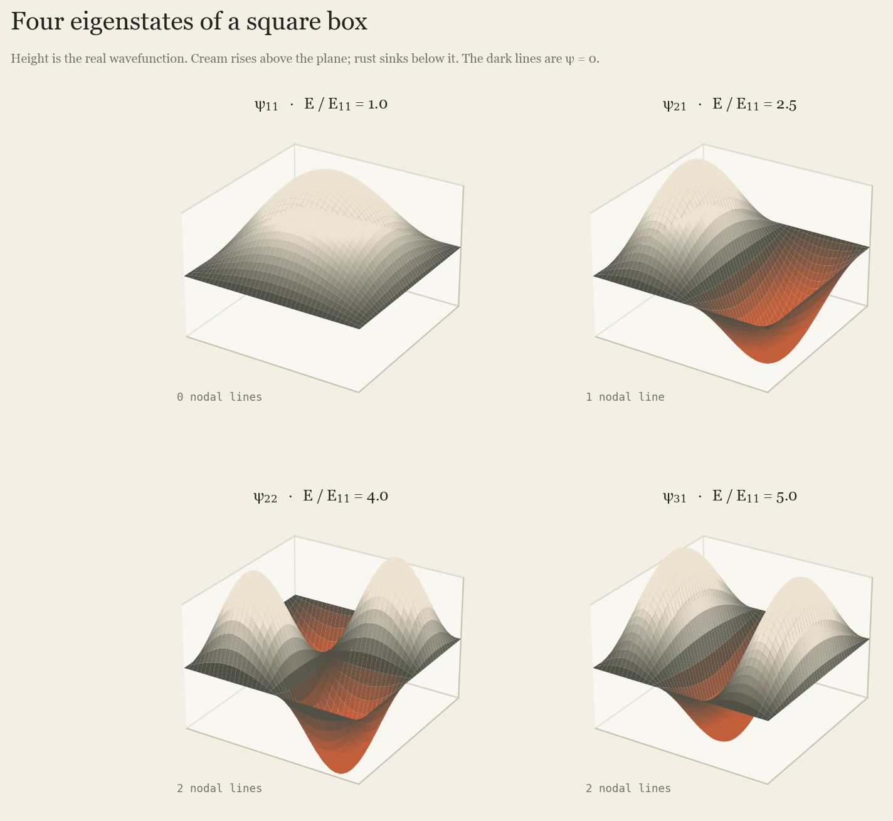
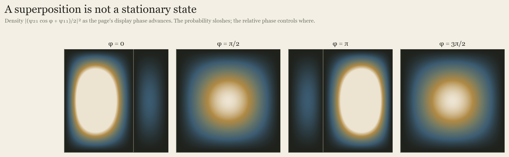
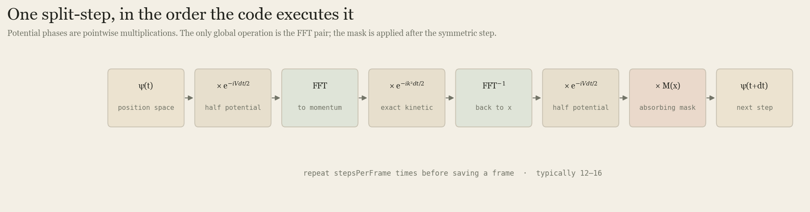
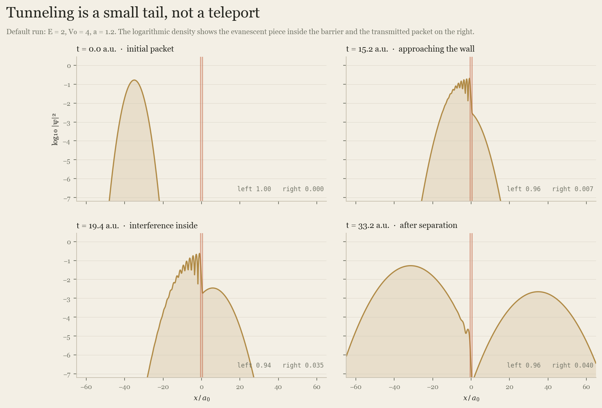
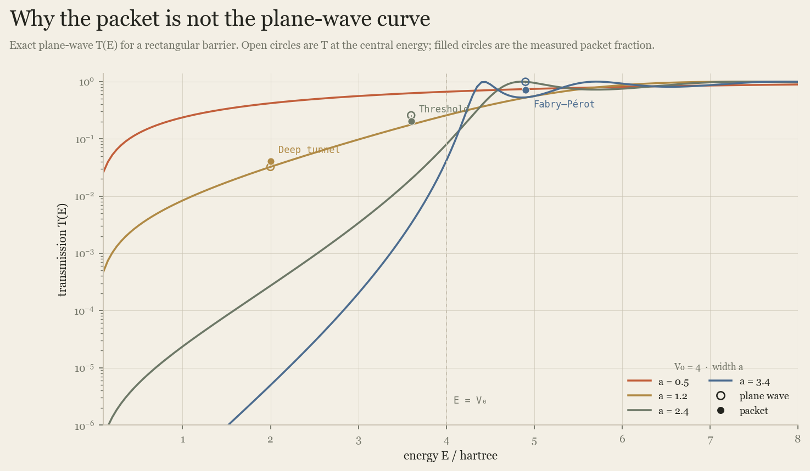
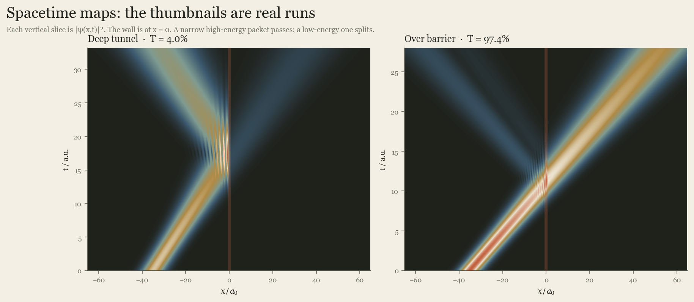

# The QuantumSim Field Guide

**From the Schrödinger equation to a browser point cloud**

This is a working explainer for the three simulations in QuantumSim, not a
generic quantum-mechanics primer. Every equation below is tied to a function in
this repository and every worked number comes from the code. Every quantitative
plate uses the same equations as the browser; the orbital and tunneling data
were exported directly from the actual JavaScript modules.

Read it in order, or use it as a reference:

1. [The three experiments](#1-the-three-experiments)
2. [Units and the one equation](#2-units-and-the-one-equation)
3. [Atomic orbitals](#3-atomic-orbitals)
4. [The two-dimensional box](#4-the-two-dimensional-box)
5. [Tunneling](#5-tunneling)
6. [How the code fits together](#6-how-the-code-fits-together)
7. [Accuracy, limits, and verification](#7-accuracy-limits-and-verification)
8. [Glossary and references](#8-glossary-and-references)

> **The short version.** QuantumSim never draws a decorative cloud. It samples
> `|ψ|²` with a Monte-Carlo sampler, evaluates an exact box eigenstate on a
> 96 × 96 mesh, or integrates the time-dependent Schrödinger equation with a
> split-step Fourier solver. The 3D layer is a way to see those numbers, not a
> replacement for them.

---

## 1. The three experiments

QuantumSim is a single static page with three hash routes. Each route owns a
different physical question.

| Route | Question | Scientific object | Main code |
| --- | --- | --- | --- |
| `#/elements` | Where is an electron likely to be? | `ψ_nlm(r)` for a hydrogen-like atom | `src/physics/orbitals.js` |
| `#/wavefunction` | What does a wavefunction look like in space? | `ψ_nx,ny(x,y)` for a particle in a square box | inline in `src/views/wavefunction.js` |
| `#/configurations` | How does probability move through a barrier? | `ψ(x,t)` from the 1D TDSE | `src/physics/tdse.js` |

They share a visual language—paper chrome, a dark measurement plate, mono
labels, a metric ribbon—but they do not share a physics shortcut. The orbital
page uses a radial CDF; the box page evaluates an analytic eigenstate; the
tunneling page runs a spectral PDE solver.



*Figure 1. The browser shell loads one ES-module entry point. The router mounts
one view at a time; the view owns its Three.js scene and cleans it up on exit.
The physics modules contain no DOM code, which is why the same functions can be
tested in Node.*

The app has no build step, no server-side computation, and no network calls at
runtime. Three.js and the fonts are vendored. That matters for the physics: the
numbers you see are computed on your machine, not fetched from a remote service.

---

## 2. Units and the one equation

### 2.1 Atomic units

The simulations use **Hartree atomic units**, the natural units of an electron
bound to a proton:

| Quantity | Symbol | Atomic unit | SI value |
| --- | --- | --- | --- |
| length | `a₀` | Bohr radius | `5.291772 × 10⁻¹¹ m` |
| energy | `Eₕ` | Hartree | `27.211386 eV` |
| time | `ħ/Eₕ` | atomic time | `2.418884 × 10⁻¹⁷ s` |
| mass | `mₑ` | electron mass | `9.109384 × 10⁻³¹ kg` |
| action | `ħ` | reduced Planck | `1.054572 × 10⁻³⁴ J·s` |

In these units `ħ = mₑ = e = 4πε₀ = 1`. The kinetic operator becomes `−½∇²`,
a plane wave has energy `E = k²/2`, and the Coulomb potential is simply
`V = −Z/r`. This removes constants from the code and makes the numbers
comparable across the three pages.

The UI converts at the edges:

- orbital radii are shown in `a₀`;
- orbital energies are converted to electron-volts with `13.605693 Z²/n² eV`;
- barrier heights and widths are shown in atomic units;
- tunneling time is shown in atomic time units (`1 a.u. ≈ 24.19 as`).

A useful scale intuition: the default tunneling barrier is `V₀ = 4 Eₕ ≈ 109 eV`
high and `a = 1.2 a₀ ≈ 0.64 Å` wide. The whole simulated encounter lasts about
`33 a.u. ≈ 0.8 fs`.

### 2.2 The equation all three pages serve

The non-relativistic, single-particle Schrödinger equation is

$$
i\hbar\frac{\partial \psi}{\partial t}
=
\left[-\frac{\hbar^2}{2m}\nabla^2 + V(\mathbf r)\right]\psi .
$$

With atomic units, it becomes

$$
i\frac{\partial \psi}{\partial t}
=
\left[-\frac12\nabla^2 + V(\mathbf r)\right]\psi .
$$

The time-independent version, obtained by writing
`ψ(r,t) = ψ(r) e^(−iEt/ħ)`, is

$$
\left[-\frac12\nabla^2 + V(\mathbf r)\right]\psi(\mathbf r)
=
E\psi(\mathbf r).
$$

The orbital page solves the Coulomb version of this equation analytically. The
box page solves the free-particle version with hard walls. The tunneling page
solves the time-dependent equation numerically with a rectangular barrier.

### 2.3 The Born rule

For a normalized state, the probability of finding the particle in a small
volume `d³r` around `r` is

$$
dP = |\psi(\mathbf r)|^2\,d^3r .
$$

`ψ` itself is complex. Its modulus squared is the measurable probability
density; its phase matters when amplitudes from different paths interfere. This
single rule explains why the orbital page draws many dots, why the box page
colors positive and negative lobes differently, and why the tunneling page
colors points by `arg ψ`.

For a spherically symmetric state, the probability of finding the electron
between radius `r` and `r + dr` is not `|R(r)|² dr`. It is

$$
P(r)\,dr = r^2 |R(r)|^2\,dr,
$$

because the shell at radius `r` has volume `4πr² dr`. The extra `r²` is the
reason a 1s cloud peaks at one Bohr radius rather than at the nucleus, even
though the density is largest at the nucleus.

---

## 3. Atomic orbitals

### 3.1 The model: one electron, an effective nucleus

The orbital page uses the hydrogen-like Hamiltonian

$$
\left[-\frac12\nabla^2 - \frac{Z_{\rm eff}}{r}\right]\psi
=
E\psi .
$$

`Z_eff` is the effective nuclear charge felt by the electron. For hydrogen it is
exactly 1. For helium and heavier atoms, it is a screening approximation: the
other electrons partially cancel the bare nuclear charge `Z`.

This is not a many-electron calculation. It is a **one-electron shape model**.
That is a deliberate trade: the exact Coulomb solutions give the correct shell
structure, radial nodes, angular lobes, and `1/Z` scaling, while remaining cheap
enough to sample tens of thousands of points in a browser.

### 3.2 Separation of variables

Because the Coulomb potential is central, the wavefunction separates in
spherical coordinates:

$$
\psi_{nlm}(r,\theta,\phi)
=
R_{nl}(r)\,Y_l^m(\theta,\phi).
$$

The integers are:

- `n = 1, 2, …` — principal quantum number, controlling shell size and energy;
- `l = 0, 1, …, n−1` — orbital angular momentum, with spectroscopic labels
  `s, p, d, f` for `l = 0, 1, 2, 3`;
- `m = −l, …, +l` — magnetic quantum number, controlling orientation.

The radial equation is

$$
\left[
-\frac{1}{2r^2}\frac{d}{dr}\left(r^2\frac{d}{dr}\right)
+\frac{l(l+1)}{2r^2}
-\frac{Z_{\rm eff}}{r}
\right]R_{nl}
=
E R_{nl}.
$$

Substituting `u(r) = rR(r)` turns it into a one-dimensional equation:

$$
-\frac12 u'' +
\left[
\frac{l(l+1)}{2r^2} - \frac{Z_{\rm eff}}{r}
\right]u
=
E u .
$$

Bound-state normalization requires `u → 0` at infinity. That condition
quantizes the energy:

$$
E_n = -\frac{Z_{\rm eff}^2}{2n^2}\ \text{hartree}
=
-13.605693\,\frac{Z_{\rm eff}^2}{n^2}\ \text{eV}.
$$

The energy depends on `n` and `Z_eff`, not on `l` or `m`. That degeneracy is a
special property of the pure Coulomb potential.

### 3.3 The exact radial function in the code

The normalized solution used by `radialFunction(n, l, z, r)` is

$$
R_{nl}(r)
=
N_{nl}
\left(\frac{2Zr}{n}\right)^l
e^{-Zr/n}
L_{n-l-1}^{\,2l+1}\!\left(\frac{2Zr}{n}\right),
$$

with

$$
N_{nl}
=
\sqrt{
\left(\frac{2Z}{n}\right)^3
\frac{(n-l-1)!}{2n\,(n+l)!}
}.
$$

Here `L_k^α` is the associated Laguerre polynomial. The code does not call a
special-function library. It evaluates the polynomial with the stable recurrence

$$
L_0^\alpha(x)=1,\qquad
L_1^\alpha(x)=1+\alpha-x,
$$

$$
L_{i+1}^\alpha(x)
=
\frac{(2i+1+\alpha-x)L_i^\alpha(x)-(i+\alpha)L_{i-1}^\alpha(x)}{i+1}.
$$

This is the loop in `laguerre(k, alpha, x)`:

```js
function laguerre(k, alpha, x) {
  if (k === 0) return 1;
  let l0 = 1;
  let l1 = 1 + alpha - x;
  for (let i = 1; i < k; i++) {
    const l2 =
      ((2 * i + 1 + alpha - x) * l1 - (i + alpha) * l0) / (i + 1);
    l0 = l1;
    l1 = l2;
  }
  return l1;
}
```

The radial function itself is then a direct translation of the formula:

```js
const rho = (2 * z * r) / n;
const norm = Math.sqrt(
  ((2 * z) / n) ** 3 * (FACT[n - l - 1] / (2 * n * FACT[n + l]))
);
return norm * Math.exp(-rho / 2) * Math.pow(rho, Math.max(0, l))
  * laguerre(n - l - 1, 2 * l + 1, rho);
```

The `Math.max(0, l)` keeps the `l = 0` case explicit at `r = 0` and avoids
relying on the engine’s convention for `0^0`.

The first few functions, written out, are:

$$
R_{10} = 2Z^{3/2}e^{-Zr},
$$

$$
R_{20}
=
\frac{1}{2\sqrt2}Z^{3/2}(2-Zr)e^{-Zr/2},
$$

$$
R_{21}
=
\frac{1}{2\sqrt6}Z^{3/2}(Zr)e^{-Zr/2}.
$$

For `Z = 1` these are the familiar hydrogen orbitals. For `Z_eff > 1` the cloud
contracts by `1/Z_eff` in every direction, while the energy deepens by
`Z_eff²`.

### 3.4 Angular shapes: real orbitals

The code uses **real** linear combinations of spherical harmonics, not the
complex `Y_l^m`. This gives the familiar directional lobes and lets the UI
color a lobe by the sign of a real number.

The unnormalized angular shapes in `angularShape` are:

| `l` | `m` | shape |
| --- | --- | --- |
| 0 | 0 | `1` |
| 1 | 0 | `cos θ` |
| 1 | ±1 | `sin θ cos φ`, `sin θ sin φ` |
| 2 | 0 | `3cos²θ − 1` |
| 2 | ±1 | `sin θ cos θ cos φ`, `sin θ cos θ sin φ` |
| 2 | ±2 | `sin²θ cos 2φ`, `sin²θ sin 2φ` |
| 3 | 0 | `5cos³θ − 3cos θ` |
| 3 | ±1 | `sin θ (5cos²θ − 1) cos φ`, `… sin φ` |
| 3 | ±2 | `sin²θ cos θ cos 2φ`, `… sin 2φ` |
| 3 | ±3 | `sin³θ cos 3φ`, `sin³θ sin 3φ` |

These are **not normalized** spherical harmonics. That is intentional: the
sampler needs only the shape, because any constant normalization cancels in the
rejection step. The sign, however, is preserved and is what the phase tint
shows.

The naming in `orbitalLabel` maps `m` to the conventional real-orbital labels.
For example:

- `2p_z` is `n=2, l=1, m=0`;
- `2p_x` is `n=2, l=1, m=1`;
- `2p_y` is `n=2, l=1, m=−1`;
- `3d_z²` is `n=3, l=2, m=0`;
- `4f_z³` is `n=4, l=3, m=0`.

### 3.5 Nodes: where the wavefunction is zero

There are two kinds of nodes, and the UI reports both:

- **radial nodes**: spheres where `R_nl(r) = 0`. There are `n − l − 1` of them.
- **angular nodes**: surfaces where `Y_l^m = 0`. There are `l` of them.

The total number of nodal surfaces is `n − 1`.

Examples:

| State | Radial nodes | Angular nodes | Total | Where the zeros are |
| --- | --- | --- | --- | --- |
| `1s` | 0 | 0 | 0 | nowhere |
| `2s` | 1 | 0 | 1 | sphere at `r = 2a₀/Z` |
| `2p_z` | 0 | 1 | 1 | plane `z = 0` |
| `3d_z²` | 0 | 2 | 2 | two cones at `θ ≈ 54.7°` and `125.3°` |
| `4f_z³` | 0 | 3 | 3 | plane `z = 0` plus cones at `θ ≈ 39.2°` and `140.8°` |
| `5f_z³` | 1 | 3 | 4 | one radial sphere plus the three `f` angular surfaces |

The `3d_z²` cones come from solving

$$
3\cos^2\theta - 1 = 0
\quad\Longrightarrow\quad
\cos\theta = \pm\frac{1}{\sqrt3}.
$$

The `4f_z³` surfaces come from

$$
\cos\theta\,(5\cos^2\theta - 3)=0,
$$

so `cos θ = 0` or `cos θ = ±√(3/5)`.

A radial node is not a dark hole in a point cloud. It is a radius at which the
radial amplitude passes through zero. With a finite number of dots, the cloud
looks thin there, not perfectly empty. Increasing the sample count makes the
node sharper.

### 3.6 Effective nuclear charge and screening

For a multi-electron atom, the bare charge `Z` is reduced by the average
repulsion of the other electrons. The app uses tabulated effective charges
inspired by Slater screening:

| Atom | `Z` | Configuration | Clouds shown | `Z_eff` values |
| --- | --- | --- | --- | --- |
| H | 1 | `1s¹` | 1s | 1.0 |
| He | 2 | `1s²` | 1s | 1.7 |
| Li | 3 | `[He] 2s¹` | 1s, 2s | 2.7, 1.3 |
| C | 6 | `[He] 2s² 2p²` | 1s, 2s, 2p_x, 2p_y | 5.7, 3.25 |
| N | 7 | `[He] 2s² 2p³` | 1s, 2s, 2p_z, 2p_x, 2p_y | 6.7, 3.9 |
| O | 8 | `[He] 2s² 2p⁴` | 1s, 2s, three p clouds | 7.7, 4.55 |
| Ne | 10 | `[He] 2s² 2p⁶` | 1s, 2s, three p clouds | 9.7, 5.85 |
| Na | 11 | `[Ne] 3s¹` | 1s, 2s, three 2p, 3s | 10.7, 6.85, 2.2 |
| Si | 14 | `[Ne] 3s² 3p²` | 1s, 2s, three 2p, 3s, 3p_x, 3p_y | 13.7, 9.15, 4.3 |

These numbers are **shape parameters**, not a self-consistent field
calculation. They are chosen to reproduce the correct qualitative trend: inner
shells feel a larger effective charge and are therefore tighter; valence
electrons feel a smaller charge and are more extended.

The Builder tab exposes `Z_eff` from 1 to 12. Moving it changes both the
sampled geometry and the displayed energy. Because every radial distance scales
as `1/Z_eff`, the whole cloud expands or contracts together.

Two honesty notes about the element clouds:

- The electron counts on the legend are representative labels, not a full
  configuration diagram. The sampler gives every orbital cloud the same number
  of points regardless of occupancy, so cloud brightness is never an
  occupancy-weighted density.
- Carbon is shown with two orthogonal `p` clouds (`p_x` and `p_y`), one
  electron each, so both directional lobes are visible. The real `2p²` state is
  a many-electron configuration with three degenerate `p` orbitals; the app is
  illustrating shape, not enumerating microstates.

---

### 3.7 Monte-Carlo sampling

The page does not draw an isosurface. It draws **samples**. The difference is
important: a dot is one possible electron position drawn from `|ψ|²`, so the
local density of dots estimates the probability density. The cloud is noisy by
design; a smoother cloud simply means more samples.

The sampler in `sampleCloud` has two independent stages: a radius from the
radial CDF, then a direction from the angular density.

#### Stage 1: invert the radial CDF

The code numerically builds

$$
F(r)=\int_0^r r'^2|R_{nl}(r')|^2\,dr'
$$

on 6,144 radial bins, out to

$$
r_{\max}=\frac{\max(16,\;4.2n^2+22)}{Z_{\rm eff}}.
$$

The upper limit is deliberately generous. For `n=1` it is `26.2/Z_eff`, far
beyond the visible 1s cloud; for `n=5` it is `127/Z_eff`. The last 1.5% of the
CDF defines the displayed extent, but samples are still drawn from the whole
truncated distribution.

Each bin contributes `P(r) dr = r²R² dr`; the running sum is normalized by the
total. The mean and the most probable radius are accumulated at the same time:

```js
const R = radialFunction(n, l, z, r);
const p = R * R * r * r;
const w = p * dr;
total += w;
weighted += r * w;
if (p > peak) { peak = p; peakR = r; }
```

To draw a radius, the code takes a uniform random number `u` and binary-searches
the CDF for the first bin with `F ≥ u`. It returns the midpoint of that bin.
That is inverse-transform sampling: if `u` is uniform on `[0,1)`, then
`r = F⁻¹(u)` has density `P(r)`.



*Figure 10. The 2s radial density and its CDF, computed from the same
`radialFunction` used by the browser. A uniform draw `u = 0.60` maps to
`r ≈ 6.35 a₀`; 60% of the radial probability lies inside that radius.*

This is why the sampler does not need rejection for the radial part. The CDF
is monotone, so the inversion is direct. The finite bin width introduces a
small discretization error—the returned radius is the bin midpoint—but with
6,144 bins it is below the visual resolution.

#### Stage 2: rejection-sample the angular density

For `s` states (`l=0`), the angular density is constant. The code samples a
uniform direction on the sphere:

```js
const u = 2 * random() - 1;      // cos θ
const phi = TAU * random();      // φ
const sint = Math.sqrt(1 - u * u);
```

For `l > 0`, the code proposes a uniform direction and accepts it with
probability

$$
\frac{|Y_l^m(\theta,\phi)|^2}{Y_{\max}^2}.
$$

A uniform sphere has constant proposal density, so accepting with probability
proportional to `|Y|²` produces a sample whose density is proportional to
`|Y|²`. The normalization constant cancels. The implementation estimates
`Y_max` once on a 96 × 192 direction grid and caches it:

```js
const value = angularShape(l, m, u, sint, cosPhi, sinPhi);
if (random() * maxSq <= value * value) { /* accept */ }
```

For a `p_z` orbital, `|cos θ|²` averages to `1/3` over the sphere, so roughly
one in three proposals is accepted. The loop allows 48 attempts and then falls
back to the last proposal. The probability of 48 consecutive rejections is
about `(2/3)^48 ≈ 3.5 × 10⁻⁹`, small enough to ignore; the fallback also
prevents an infinite loop at a pathological maximum estimate.

The angular code is deliberately using an **unnormalized** shape. Only the
relative `|Y|²` matters for sampling. The sign is kept separately for the phase
tint.

#### The random sequence is deterministic

The code uses a small `mulberry32` PRNG seeded from the element, orbital index,
and builder `n`. Reloading an element gives the same cloud rather than a new
random cloud every frame. That makes the visualization stable while scrubbing
controls, and makes the figures in this guide reproducible.

Default rendering uses **30,000 points per orbital**. The slider ranges from
10,000 to 60,000 in steps of 5,000. A heavier atom with several clouds can
therefore draw roughly 240,000 points, which is still inexpensive for WebGL.

### 3.8 What the sampler produces

The following numbers are from the actual code, with 60,000 samples per state.
They agree with the analytic expectation values to the displayed precision.

| State | `n,l,m` | Radial nodes | Angular nodes | Mean `⟨r⟩` | Radial peak | 98.5% extent |
| --- | --- | --- | --- | --- | --- | --- |
| H `1s` | 1,0,0 | 0 | 0 | 1.50 `a₀` | 1.00 `a₀` | 3.94 `a₀` |
| H `2s` | 2,0,0 | 1 | 0 | 6.00 `a₀` | 5.24 `a₀` | 12.14 `a₀` |
| H `2p_z` | 2,1,0 | 0 | 1 | 5.00 `a₀` | 4.00 `a₀` | 11.01 `a₀` |
| H `3d_z²` | 3,2,0 | 0 | 2 | 10.50 `a₀` | 9.00 `a₀` | 20.87 `a₀` |
| H `4f_z³` | 4,3,0 | 0 | 3 | 18.00 `a₀` | 16.00 `a₀` | 33.38 `a₀` |
| `5f_z³`, `Z_eff=2.4` | 5,3,0 | 1 | 3 | 13.12 `a₀` | 13.67 `a₀` | 22.77 `a₀` |

The analytic mean radius is

$$
\langle r\rangle = \frac{3n^2-l(l+1)}{2Z_{\rm eff}},
$$

which gives `1.5`, `6`, `5`, `10.5`, `18`, and `13.125` for the rows above.
The code’s radial integral reproduces those values because the CDF covers the
tail far enough for the mean to converge.



*Figure 2. `P(r) = r²|R_nl|²` for four hydrogenic states, normalized to unit
area. The dashed line is `⟨r⟩`; the 2s curve has a genuine zero at `r = 2a₀`.*



*Figure 3. 12,000 points per state, drawn by `sampleCloud` and projected onto
the `x–z` plane. Cream and rust mark the sign of the real wavefunction. The
radial scale differs between panels; each bar is labeled.*

### 3.9 Worked examples

#### Hydrogen 1s

For `Z=1`, `R₁₀(r)=2e^{-r}` and the density is

$$
|\psi_{100}|^2 = \frac{1}{\pi}e^{-2r}.
$$

The radial probability is `P(r)=4r²e^{-2r}`. Setting `dP/dr=0` gives `r=1a₀`,
and the mean is `1.5a₀`. The probability inside the Bohr radius is

$$
\int_0^1 4r^2e^{-2r}dr
=1-\frac{5}{e^2}
\approx 0.323.
$$

So a hydrogen 1s electron is found inside one Bohr radius about 32% of the
time. The cloud still looks diffuse because the remaining 68% extends into the
tail.

#### Hydrogen 2s: a node and two lobes

The 2s radial function is proportional to `(2−r)e^{-r/2}`. It changes sign at
`r=2a₀`, so the 2s cloud has an inner spherical lobe and an outer spherical
lobe separated by a radial node. The code’s mean is `6.00a₀`; the CDF gives a
median radius near `5.78a₀` and the 60% radius near `6.35a₀`. A node is a zero of
the amplitude, not a region of negative probability; the probability density is
zero there because the amplitude is zero.

#### Hydrogen 2p_z: a plane, not a ring

The `2p_z` angular shape is `cos θ`, so the density is proportional to
`cos²θ`. It has two lobes on the `z` axis and a nodal plane at `z=0`. The mean
radius is `5a₀`, larger than 1s but smaller than 3d. The radial function has no
node (`n−l−1=0`), so the cloud is one thick pair of lobes rather than nested
shells.

#### Hydrogen 3d_z²: cones

The `3d_z²` shape `3cos²θ−1` is positive along the poles, negative in the
 equatorial belt, and zero on two cones. The radial function has no node. The
mean radius is `10.5a₀`, and the most probable radius is `9a₀`. The name “z²”
does not mean the density is a vertical line; it is a quadrupole-shaped cloud
with a doughnut-like negative region around the equator.

#### Hydrogen 4f_z³: three angular zeros

The `4f_z³` shape has a nodal plane and two conical nodes. The radial function
has no node, so all three zeros are angular. The mean radius is `18a₀`; the
radial peak is `16a₀`; the 98.5% extent is about `33a₀`. This is the first state
in the builder where the angular structure is richer than a simple lobe pair.

#### 5f at `Z_eff = 2.4`: contraction and a radial node

The Builder supports `n=5, l=3` (5f). At `Z_eff=2.4` the code reports
`⟨r⟩=13.12a₀`, a radial peak at `13.67a₀`, and a 98.5% extent of `22.77a₀`.
The state has one radial node (`n−l−1=1`) and three angular nodes. Its energy is

$$
-13.605693\frac{2.4^2}{5^2}\ \text{eV}
\approx -3.13\ \text{eV}.
$$

Compare that with the same `n=5` at `Z_eff=1`: the cloud would be 2.4 times
larger and the binding energy 5.76 times shallower. This is the `1/Z` and `Z²`
scaling the slider is meant to expose.

### 3.10 From samples to the scene

The view converts the sampler’s arrays into a `THREE.BufferGeometry` with one
position and one color per vertex. The positions are already Cartesian:

```js
positions[i * 3]     = r * st * cp;   // x
positions[i * 3 + 1] = r * st * sp;   // y
positions[i * 3 + 2] = r * ct;        // z
```

The orbital sampler treats `z` as the polar axis. Three.js treats `y` as up,
so the cloud group is rotated by `−π/2` about `x`; the visual vertical axis then
corresponds to the physical `z` axis.

Each point gets a `PointsMaterial` sprite. The sprite is a small radial
texture, not a physical glow; it exists to make a dot legible at small screen
sizes. `depthWrite` is off and `alphaTest` is small, so overlapping dots are
blended rather than punching holes in each other.

The element mode colors each cloud with its element palette. The Builder mode
can instead color by the sign of `ψ`: cream for positive, rust for negative.
That is a **phase sign**, not a time-dependent phase; these are real
wavefunctions. The density of points is still `|ψ|²` either way.

## 4. The two-dimensional box

### 4.1 The physics

The Wavefunction page uses the simplest non-Coulomb bound state: a particle
confined to a square box with infinite walls. Inside the box the potential is
zero; outside it is infinite. The wavefunction must vanish on the walls.

With the box taken as `0 ≤ x ≤ 1`, `0 ≤ y ≤ 1`, separation of variables gives

$$
\psi_{n_xn_y}(x,y)
=2\sin(n_x\pi x)\sin(n_y\pi y),
\qquad n_x,n_y=1,2,\ldots
$$

The factor 2 normalizes the state over the unit square. The energy is

$$
E_{n_xn_y}
=\frac{\pi^2}{2}\left(n_x^2+n_y^2\right)
=\frac{n_x^2+n_y^2}{2}\,E_{11},
$$

where `E₁₁ = π²/2 ≈ 4.9348` hartree `≈ 134.3 eV`.

The page labels energy in units of `E₁₁`, which is why the ribbon shows
`E/E₁₁ = 2.5` for `ψ₂₁`, `4.0` for `ψ₂₂`, and `5.0` for `ψ₃₁`.

### 4.2 Nodes in the box

The eigenstate has `n_x−1` vertical nodal lines and `n_y−1` horizontal nodal
lines. The total is `n_x+n_y−2` nodal lines. The ribbon reports them separately.

| State | `E/E₁₁` | Vertical nodes | Horizontal nodes | Total |
| --- | --- | --- | --- | --- |
| `ψ₁₁` | 1.0 | 0 | 0 | 0 |
| `ψ₂₁` | 2.5 | 1 | 0 | 1 |
| `ψ₂₂` | 4.0 | 1 | 1 | 2 |
| `ψ₃₁` | 5.0 | 2 | 0 | 2 |



*Figure 4. The real wavefunction `ψ_nx,ny` on the unit square. Height is the
signed amplitude; the dark lines are the zeros. The four panels use the same
height scale, so the number of lobes and the sign changes are directly
comparable.*

### 4.3 How the surface is built

The Three.js geometry is a `PlaneGeometry(2, 2, 96, 96)`. Its local coordinates
run from `−1` to `+1`; the view maps them to the box coordinate `[0,1]` with

$$
u=\frac{x_{\rm local}+1}{2}.
$$

It then evaluates

```js
const a =
  Math.sin((state.nx * Math.PI * (x + 1)) / 2) *
  Math.sin((state.ny * Math.PI * (y + 1)) / 2);
```

which is exactly `sin(n_xπu) sin(n_yπv)` after the substitution. The mesh has
`97 × 97 = 9,409` vertices and is triangulated by `PlaneGeometry`.

For the signed view, the vertex height is `a * state.height`. For the density
view, the height is `a²`. Vertex colors interpolate from the dark plate through
the positive cream or negative rust, using `|a|` as the blend factor. The
surface is lit with a hemisphere light and two directional lights; normals are
recomputed after every update so the curvature reads correctly.

The vertical height is a **display amplitude**, not a physical probability.
The page normalizes surface height only for visual scale. The ribbon’s “Peak
density” is the maximum absolute display value, not `∫|ψ|²`. This is a
visualization choice, stated explicitly here so the picture is not over-read.

### 4.4 Superposition and the beat

A single eigenstate is stationary: its probability density does not change with
time. The wavefunction acquires a global phase `e^{−iEt/ħ}`, but a global phase
cancels in `|ψ|²`. The page’s animation is therefore about a **superposition**,
not a single state.

For two normalized states, the physical superposition is

$$
\Psi(t)=\frac{1}{\sqrt2}\left(\psi_{21}e^{-iE_{21}t/\hbar}
+\psi_{11}e^{-iE_{11}t/\hbar}\right).
$$

The density contains an interference term proportional to

$$
2\psi_{21}\psi_{11}\cos\!\left(\frac{(E_{21}-E_{11})t}{\hbar}\right).
$$

That cross term oscillates at the beat frequency
`ω = (E₂₁−E₁₁)/ħ`; the density “sloshes” left and right while each eigenstate
itself is stationary.

For the box, `E₂₁−E₁₁ = 1.5E₁₁ = 3π²/4`, so the physical beat period is

$$
T=\frac{2\pi}{\Delta E}
=\frac{8}{3\pi}
\approx 0.849\ \text{atomic time units}
\approx 20.5\ \text{as}.
$$

The page does **not** run that physical clock. It advances a display phase at
`0.85 rad` per wall-clock second, so the animation is a slowed illustration,
not a real-time solution. The code’s display mix is also

```js
value = (a * Math.cos(state.phase) + ground) / 2;
```

not the normalized `1/√2` superposition. The division by 2 keeps the surface
within the plate; it changes the contrast, not the qualitative sloshing. This
is the right place to be precise: the page shows the *geometry of the cross
term*, not a calibrated physical amplitude.



*Figure 5. `|(ψ₂₁ cos φ + ψ₁₁)/2|²` at four display phases, using the exact
expression in `wavefunction.js`. At `φ = π/2` and `3π/2` the cross term
vanishes and only the ground-state density remains; those two panels are
identical by construction, not by a plotting accident.*

### 4.5 Reading the Wavefunction page

The page’s controls map directly to the math:

- **n_x, n_y** choose the eigenstate and therefore the energy and nodes.
- **ψ signed / |ψ|² density** switches between the amplitude and its square.
- **Superpose ground state** adds `ψ₁₁` and animates the relative phase.
- **Amplitude** changes the mesh height only; it does not change the physics.

A useful experiment is to compare `ψ₂₁` and `ψ₂₂`. `ψ₂₁` has one vertical node
and two lobes; `ψ₂₂` has one vertical and one horizontal node and four lobes.
Their energies are `2.5E₁₁` and `4.0E₁₁`; the extra node costs energy. This is
the two-dimensional analogue of the radial/angular node counting on the orbital
page.

### 4.6 Limits of the box page

- It is a **2D** infinite square well. There is no `z` dynamics; the 3D camera
  is a viewing tool, not a third spatial dimension.
- The surface height and color are display quantities. The probability density
  is `|ψ|²` before the height scaling, but the mesh is not area-normalized.
- The superposition is an illustrative display mix, not a TDSE integration.
  The actual time evolution would be a phase rotation at the physical beat
  frequency, which is far too fast for a hand-controlled animation.
- The walls are ideal infinite walls. A finite well would produce evanescent
  tails outside the box, which this page does not show.

## 5. Tunneling

### 5.1 The time-dependent problem

The Tunneling page solves the one-dimensional time-dependent Schrödinger
equation

$$
i\frac{\partial\psi}{\partial t}
=
\left[-\frac12\frac{\partial^2}{\partial x^2}+V(x)\right]\psi .
$$

The particle is prepared as a normalized Gaussian wave packet moving to the
right:

$$
\psi(x,0)
=
A\exp\!\left[-\frac{(x-x_0)^2}{4\sigma^2}\right]e^{ik_0x},
\qquad
A=(2\pi\sigma^2)^{-1/4}.
$$

`σ` is the position-space width, `x₀` is the starting center, and `k₀` is the
central wavenumber. The central energy and group velocity are

$$
E=\frac{k_0^2}{2},\qquad k_0=\sqrt{2E},\qquad v_g=k_0.
$$

The code builds the real and imaginary parts separately and then normalizes
the discretized array so that `∫|ψ|² dx = 1`. The initial packet is not a
plane wave: it is a superposition of momenta, which is the key to interpreting
the measured transmission later.

### 5.2 The barrier

The potential is a rectangular barrier centered at the origin:

$$
V(x)=
\begin{cases}
V_0, & |x|\le a/2,\\
0, & |x|>a/2.
\end{cases}
$$

`V₀` is the height and `a` the width. The packet starts at `x₀ < 0` and travels
toward the barrier. In the default run:

- `E = 2 Eₕ ≈ 54.4 eV`;
- `V₀ = 4 Eₕ ≈ 108.8 eV`;
- `a = 1.2 a₀ ≈ 0.635 Å`;
- `σ = 2.4 a₀ ≈ 1.27 Å`;
- `k₀ = 2 a.u.`, so the de Broglie wavelength is `2π/k₀ = π a₀ ≈ 1.66 Å`.

Classically, a particle with `E < V₀` cannot enter the barrier at all. Quantum
mechanically, the wavefunction is nonzero inside and a small transmitted wave
appears on the right.

### 5.3 Why split-step Fourier?

The formal solution over a time step is

$$
\psi(t+\Delta t)=e^{-i(\hat T+\hat V)\Delta t}\psi(t).
$$

The kinetic and potential operators do not commute, so the exponential cannot
simply be split into two separate exponentials. The symmetric **Strang
splitting** makes a second-order approximation:

$$
e^{-i(\hat T+\hat V)\Delta t}
\approx
e^{-i\hat V\Delta t/2}
e^{-i\hat T\Delta t}
e^{-i\hat V\Delta t/2}
+O(\Delta t^3).
$$

The kinetic operator is diagonal in momentum space:

$$
\hat T=\frac{\hat k^2}{2},\qquad
\langle k|e^{-i\hat T\Delta t}|k\rangle
=e^{-ik^2\Delta t/2}.
$$

That is why the algorithm alternates between position space and momentum
space. The potential phases are pointwise multiplications in `x`; the kinetic
phase is a pointwise multiplication in `k`. The FFT moves between the two
representations.



*Figure 9. One time step in execution order. The FFT pair is the only global
operation; the potential phases and the absorbing mask are diagonal in position
space.*

The code’s inner loop is exactly this sequence:

```js
// half potential
for (let i = 0; i < N; i++) { /* multiply by e^{-iV dt/2} */ }

// full kinetic step in momentum space
fft(psiR, psiI);
for (let i = 0; i < N; i++) { /* multiply by e^{-ik^2 dt/2} */ }
ifft(psiR, psiI);

// half potential again
for (let i = 0; i < N; i++) { /* multiply by e^{-iV dt/2} */ }

// absorbing mask
for (let i = 0; i < N; i++) { psiR[i] *= absorb[i]; psiI[i] *= absorb[i]; }
```

#### The FFT

`src/physics/fft.js` is an in-place iterative radix-2 Cooley–Tukey FFT. It
requires a power-of-two length (the solver uses 1,024 or 512 points). The
forward transform is

$$
\tilde\psi_j=\sum_{m=0}^{N-1}\psi_m e^{-2\pi ijm/N}.
$$

The inverse is implemented by conjugating, running the same forward transform,
and dividing by `N`:

$$
\mathcal F^{-1}(\psi)=\frac{1}{N}\overline{\mathcal F(\bar\psi)}.
$$

The code does a bit-reversal permutation, then combines butterflies at
increasing lengths. This is standard, but it matters for the page: the kinetic
step is exact on the periodic grid, not a finite-difference approximation. The
error in the method comes from the splitting, the absorbing boundary, and the
finite grid—not from the kinetic derivative.

### 5.4 The grid

The simulation uses

| Setting | Value |
| --- | --- |
| grid points `N` | 1,024 |
| domain length `L` | 200 `a₀` |
| spacing `Δx` | `L/N = 0.1953125 a₀` |
| grid coordinate | `x_j = −L/2 + (j+½)Δx` |
| wavenumber | `k_j = 2πn_j/L` with FFT frequency ordering |
| Nyquist wavenumber | `π/Δx ≈ 16.09 a.u.` |
| displayed region | `−65 … 65 a₀` |
| absorbing mask onset | `|x| = 78 a₀` |
| saved frames | 121 (`t=0` through `t=t_end`) |

The half-grid offset avoids placing a grid point exactly on a sharp barrier
edge in the common case, but the barrier is still sampled at discrete points.
That is one of the numerical limitations discussed later.

### 5.5 Time stepping and the mask

The end time is chosen to let the packet travel to the barrier and separate:

$$
t_{\rm end}
=
\operatorname{clamp}\!\left(
\frac{|x_0|-a/2}{k_0}+16,\;28,\;52
\right).
$$

For the default this is `33.2 a.u.` The code chooses at least four steps per
saved frame and increases the count for longer runs:

$$
\text{stepsPerFrame}
=
\max\!\left(4,
\left\lceil\frac{t_{\rm end}}{120\cdot 0.02}\right\rceil\right).
$$

The default gets 14 steps per frame, so

$$
\Delta t=\frac{33.2}{120\cdot 14}\approx 0.019762\ \text{a.u.}
$$

and the full run is `120 × 14 = 1,680` split-step iterations. The view’s timeline
indexes saved frames, not individual time steps; a displayed frame is separated
by `14Δt ≈ 0.277 a.u.`

The FFT domain is periodic. Without an absorber, a packet leaving the right
edge would re-enter from the left. The solver multiplies by a smooth mask after
the split step:

$$
M(x)=
\begin{cases}
1, & |x|\le 78,\\
\exp\!\left[-0.035\left(\frac{|x|-78}{20}\right)^2\right], & |x|>78.
\end{cases}
$$

This is gentle near the onset and stronger toward the domain edge. It is not a
perfect open boundary; the norm readout exposes whatever probability has been
absorbed. All six presets in the current range finish with a norm of at least
`0.999998`, but the mask is still an approximation, not a theorem.

### 5.6 What is measured

The solver integrates the density in three regions:

$$
P_{\rm left}(t)=\int_{x<-a/2}|\psi|^2dx,\qquad
P_{\rm inside}(t)=\int_{-a/2}^{a/2}|\psi|^2dx,\qquad
P_{\rm right}(t)=\int_{x>a/2}|\psi|^2dx.
$$

They are divided by their instantaneous total so the three displayed
percentages sum to 100%. The right-hand value at the final frame is reported as
the **packet transmission**. The left-hand value is the reflected fraction.

The norm is

$$
\langle\psi|\psi\rangle=\int|\psi(x,t)|^2dx,
$$

computed with the grid spacing. Before the mask acts, the split-step is unitary
and the norm is conserved to floating-point precision. The mask deliberately
removes probability near the edges; the norm readout is the honest accounting.

For the default run:

| Quantity | Value |
| --- | --- |
| norm | `1.0000` |
| final left | `0.9596` |
| final right (packet transmission) | `0.0404` (4.04%) |
| plane-wave `T(E)` at `E=2` | `0.0324` (3.24%) |
| `t_end` | `33.2 a.u.` |
| `Δt` | `0.019762 a.u.` |
| steps per frame | 14 |
| saved frames | 121 |

The packet transmits slightly more than the plane-wave value at the central
energy. That is not a solver error. The Gaussian packet contains a range of
energies, including components above the barrier; the measured fraction is the
transmission of the prepared state, not the transmission of a single `k`.



*Figure 6. Four saved frames from the actual default simulation. The vertical
axis is `log₁₀|ψ|²` so the evanescent tail inside the barrier and the small
transmitted packet remain visible; the app itself displays linear density as a
point cloud.*

### 5.7 Exact plane-wave transmission

For a single plane wave of energy `E` incident on a rectangular barrier, the
steady-state transmission is obtained by matching `ψ` and `ψ′` at both edges.
The result used by `planeWaveTransmission` is:

**Below the barrier (`E < V₀`):**

$$
\kappa=\sqrt{2(V_0-E)},
\qquad
T(E)=\left[
1+\frac{V_0^2\sinh^2(\kappa a)}{4E(V_0-E)}
\right]^{-1}.
$$

**Above the barrier (`E > V₀`):**

$$
q=\sqrt{2(E-V_0)},
\qquad
T(E)=\left[
1+\frac{V_0^2\sin^2(qa)}{4E(E-V_0)}
\right]^{-1}.
$$

**At threshold (`E = V₀`):**

$$
T=\frac{1}{1+V_0a^2/2}.
$$

For a plane wave, `R = 1−T`. The formulas describe an infinite monochromatic
wave, not the finite Gaussian packet.



*Figure 8. Exact `T(E)` for a barrier of height `V₀=4` and four widths. Open
circles mark the central-energy plane-wave value for three presets; filled
circles mark the transmission actually measured from the packet run. The gap
between them is the energy spread of the packet.*

#### Tunneling, over-barrier reflection, and resonances

Below the barrier, `T` is exponentially small in the barrier width. The exact
formula is the reliable statement; the familiar `T ~ e^{−2κa}` is the thick
barrier limit.

Above the barrier, classical mechanics would say “always passes,” but the wave
partially reflects at each potential step. The interference between reflections
from the two edges makes `T` oscillate with `qa`. When

$$
qa=n\pi,\qquad n=1,2,\dots
$$

the plane-wave transmission reaches 1: an above-barrier **Fabry–Pérot**
resonance.

For the `V₀=4`, `a=2.4` preset, the lowest resonance is at

$$
E_1=4+\frac{\pi^2}{2(2.4)^2}\approx 4.857\ \text{hartree}.
$$

The preset uses `E=4.9`, close to that resonance. Its plane-wave `T` is
`99.45%`. The packet measures only `71.0%` because the finite packet has a
spread of energies and because the resonance is narrow compared with that
spread.

### 5.8 Why the packet differs from the curve

The initial Gaussian has a momentum-space width

$$
\sigma_k=\frac{1}{2\sigma}.
$$

For the default `σ=2.4`, `σ_k≈0.208`. With `k₀=2`, the relative energy spread
is roughly

$$
\frac{\Delta E}{E}\approx\frac{2\sigma_k}{k_0}
=\frac{1}{\sigma k_0}
\approx 0.208,
$$

about 21%. The packet is a weighted sum over energies, so its transmitted
fraction is a weighted average of `T(E)` over that distribution. Near a sharp
threshold or a narrow resonance, the average can differ substantially from
`T` at the center.

The packet also disperses. For a free Gaussian,

$$
\sigma(t)=\sigma\sqrt{1+\left(\frac{t}{2\sigma^2}\right)^2}.
$$

For the default, the width grows from `2.4` to about `4.3a₀` by the time the
packet reaches the barrier (`t≈17a.u.`), and to about `7.3a₀` by the end of the
run. That spreading is quantum dispersion, not numerical diffusion. A narrower
packet would spread faster and have a broader energy distribution; a wider
packet would have a narrower energy distribution but a less localized initial
position.

This is the central pedagogical point of the page: **the analytic curve and the
packet result answer different questions.** The curve is the exact answer for
one energy. The packet is the answer for the state the app actually prepared.

### 5.9 Presets and measured results

| Preset | `E` | `V₀` | `a` | plane `T` | packet `T` | norm | `t_end` |
| --- | --- | --- | --- | --- | --- | --- | --- |
| Deep tunnel | 2.0 | 4.0 | 1.2 | 3.24% | 4.04% | 1.0000 | 33.2 |
| Threshold | 3.6 | 4.0 | 1.0 | 25.76% | 20.30% | 1.0000 | 28.9 |
| Over barrier | 5.0 | 2.0 | 1.4 | 99.47% | 97.36% | 1.0000 | 28.0 |
| Wide wall | 2.6 | 2.8 | 3.4 | 1.46% | 15.00% | 1.0000 | 30.6 |
| Thin wall | 1.4 | 6.5 | 0.5 | 10.76% | 21.56% | 1.0000 | 36.8 |
| Fabry–Pérot | 4.9 | 4.0 | 2.4 | 99.45% | 71.05% | 1.0000 | 28.0 |

The wide-wall case is the most dramatic difference: the central energy is
below the barrier, so the plane-wave `T` is only 1.46%, but the high-energy tail
of the packet is above the barrier and contributes a much larger transmitted
fraction. The Fabry–Pérot case goes the other way: the central energy sits near
a narrow resonance, but the packet’s energy spread averages over the resonance
and reduces the measured transmission.



*Figure 7. Position–time density maps from the actual solver. The wall is the
vertical rust band at `x=0`. The left panel is the deep-tunneling preset; the
right panel is the over-barrier preset. The preset thumbnails in the sidebar
are built from the same solver with a smaller frame count.*

### 5.10 How the 3D tunneling cloud is made

The physical calculation is one-dimensional. The page turns `|ψ(x,t)|²` into a
3D point cloud for perception:

1. For each saved frame, build a cumulative distribution over the displayed
   `x` range (`−65…65a₀`).
2. Generate 9,000 fixed quantiles `q_i = (i + u_i)/9000` once.
3. For each frame, invert the CDF at those quantiles to get 9,000 `x` values.
   Fixed quantiles make the cloud move smoothly instead of flickering between
   independent random samples.
4. Give each point a fixed transverse offset drawn from a 2D Gaussian
   (`radius = min(4.6, √(−2 ln U)) × 2`, random angle). This turns the line
   density into a visible tube.
5. Color each point by the phase `arg ψ(x,t)`, using a cyclic palette.
6. Draw an amber slab whose `x` scale is the true barrier width.

The transverse offsets do not evolve. They are not particle trajectories; they
are a fixed visual embedding. The phase color is only meaningful where the
density is non-negligible, which is why the palette disappears in the empty
regions.

The barrier slab’s height and depth are presentational. Only its width along
`x` is physical. The floor grid and axis are orientation aids.

### 5.11 Thumbnails

Each preset button contains a small `x–t` canvas. `buildThumbnail` runs the same
`simulate` function with 48 saved frames, normalizes the density, applies a
power curve (`density^0.42`) so low-density features remain visible, and paints
a pixel map. The initial label is the analytic plane-wave `T`; once the
thumbnail run finishes, the label is replaced with the measured packet `T`.
That is why a preset can briefly show a plane-wave number and then settle on a
slightly different measured value.

### 5.12 Limits of the tunneling model

- It is **1D** and single-particle. There is no transverse scattering, spin,
  magnetic field, or photon emission.
- The barrier is ideal and rectangular. Real barriers are smooth, finite, and
  often time-dependent.
- The narrowest preset (`a=0.5a₀`) spans only about 2.6 grid cells. Its result
  is qualitatively useful but not grid-converged.
- The absorbing mask is an approximation to an open boundary. The norm readout
  is the honest diagnostic.
- The 3D cloud is a visualization of a 1D density, not a 3D simulation.

## 6. How the code fits together

### 6.1 The router owns the lifecycle

`index.html` is only a shell: masthead, three links, a main element, a font
preload, and an import map for Three.js. `src/app.js` maps hash routes to mount
functions:

```js
const ROUTES = {
  elements:       { mount: mountElementsPage,       title: "Orbitals — QuantumSim" },
  wavefunction:   { mount: mountWavefunctionPage,   title: "Wavefunction — QuantumSim" },
  configurations: { mount: mountConfigurationsPage, title: "Tunneling — QuantumSim" },
};
```

On a route change the router calls the previous view’s cleanup, clears the
container, sets the document title and active navigation link, and calls the new
mount. Each mount returns a function; that function stops the render loop,
removes listeners, and disposes GPU resources. This is why switching pages does
not leave a second animation loop running.

```js
cleanup?.();
app.innerHTML = "";
try {
  cleanup = ROUTES[route].mount(app) ?? null;
} catch (error) {
  showError(error);
}
```

The `pagehide` listener calls cleanup when the tab goes away. The router also
normalizes a bare URL to `#/elements`.

### 6.2 The shared stage

`src/stage.js` creates one renderer, perspective camera, OrbitControls instance,
resize observer, and `requestAnimationFrame` loop per page. The important
contract is simple: scenes add objects; `stage.start(callback)` runs a callback
once per animation frame and then renders; `stage.dispose()` recursively
disposes geometries, materials, and textures.

```js
const loop = () => {
  if (!running || disposed) return;
  rafId = requestAnimationFrame(loop);
  const dt = Math.min(0.05, clock.getDelta());
  controls.update(dt);
  if (frameCallback) frameCallback(dt);
  renderer.render(scene, camera);
};
```

The renderer clamps device pixel ratio to 2, uses `SRGBColorSpace`, and has a
transparent clear color so the paper plate shows through. The camera controls
are damped; the `dt` clamp prevents a background tab restore from producing a
huge phase jump.

`makeGlowTexture()` draws a 48 × 48 radial sprite on a canvas. It is a soft dot,
not a physical light. `makeTextSprite()` draws axis labels into a canvas texture
and returns a camera-facing sprite. `makeGradient()` interpolates the phase
palette.

### 6.3 UI state and debouncing

`src/ui.js` provides three primitives:

- `createSlider` — range input with a painted fill, formatted value, unit, and
  min/max labels;
- `createSwitch` — an accessible `role="switch"` button;
- `createSegmented` — a row of mutually exclusive buttons.

They are deliberately small and view-agnostic. The views own the state; the
controls only call `onInput` or `onChange`.

The orbital view debounces rebuilds by 130 ms. The tunneling view debounces a
new solve by 170 ms. A simulation is synchronous JavaScript, so the code yields
for one frame with `setTimeout` (18–24 ms) before doing the heavy work; that lets
the loader paint before the main thread is occupied.

### 6.4 Performance budget

The three pages have different costs:

| Page | Work | Typical cost |
| --- | --- | --- |
| Orbitals | 30k samples per cloud; up to ~240k points | Sampling is CPU; rendering is one draw call per cloud |
| Box | 9,409 vertices; recompute normals and colors | ~9k vertex updates per animation frame while mixing |
| Tunneling | 1,024 grid points × 1,680 steps; 9,000 samples × 121 frames | Solver runs once; playback only swaps buffers |

The tunneling page precomputes all 121 frames and all 9,000 sample positions
before playback. Scrubbing and play/pause do not re-run the solver. This is the
right trade: a short wait up front, then smooth 30 fps playback.

The preset thumbnails each run a 48-frame solve after the main page boots.
They are staggered by 130 ms to avoid a single long block. They are the most
expensive secondary work on the page; if the app were extended to many more
presets, the thumbnail generation would be the first thing to move to a worker.

### 6.5 Data flow, end to end

For the orbital page:

```text
ELEMENTS data
  -> mountElementsPage()
  -> sampleCloud({n,l,m,zEff,count,seed})
  -> radialFunction + Laguerre + angularShape
  -> Float32Array positions, Int8Array signs
  -> THREE.BufferGeometry + PointsMaterial
  -> scene
```

For the box page:

```text
nx, ny, display, mix, phase
  -> updateSurface()
  -> 9,409 vertex heights and colors
  -> computeVertexNormals()
  -> MeshStandardMaterial surface
```

For the tunneling page:

```text
energy, barrier, width, sigma, x0
  -> normalizeParams()
  -> simulate({frames: 120})
  -> split-step TDSE
  -> density[121][1024], phase[121][1024]
  -> buildSamples() -> xs[121][9000]
  -> writeFrame() -> BufferGeometry attributes
  -> playback / scrub
```

### 6.6 Adding another orbital state

The Builder already covers every `n=1…5`, `l=0…3`, and real `m`. To add an
element or a preset, the narrowest change is data, not physics:

1. Add a cloud definition to `src/data/elements.js` with `n`, `l`, `m`,
   `zEff`, occupancy label, color, and opacity.
2. If the new element should appear in the specimen index, add the element
   object with its reference properties.
3. The existing sampler, legend, ribbon, and camera fit will handle it; no new
   shader or geometry code is required.

For a new box state, extend the segmented options in `wavefunction.js`. The
surface update is generic in `nx` and `ny`. For a new tunneling preset, add an
entry to `PRESETS`; the thumbnail builder and measured label are automatic.

## 7. Accuracy, limits, and verification

### 7.1 Where the numbers come from

The app is honest about its approximations if you read the code:

- **Orbitals** are exact non-relativistic hydrogenic radial functions with a
  real angular shape. The many-electron atom is represented by a single
  effective charge. There is no exchange, correlation, spin, fine structure, or
  relativistic correction. The reference ionization energies, radii, and
  electronegativities are measured values, not outputs of the orbital model.
- **The box** is an ideal 2D infinite well. The surface is a display mesh; the
  superposition animation is not a TDSE integration and does not use physical
  wall-clock time.
- **Tunneling** is a 1D single-particle TDSE with an ideal rectangular barrier
  and a smooth absorber. The exact plane-wave formula is a reference, not the
  same observable as the finite packet.

### 7.2 Numerical error sources

| Source | Effect | Mitigation |
| --- | --- | --- |
| Radial CDF discretization (6,144 bins) | Tiny radius bias, sub-visual | Fine bins; midpoint inversion |
| Angular envelope grid (96 × 192) | Slight rejection bias | 48-attempt cap; normalization cancels |
| Finite sample count (10k–60k) | Visible grain | More points; deterministic seed |
| Barrier sampled on grid | Narrow barrier under-resolved | Keep `a=0.5` qualitative |
| Split-step `O(Δt³)` local error | Small phase error | `Δt≈0.02`; 12–16 steps/frame |
| Absorbing mask | Norm loss near edges | Gentle mask; norm readout |
| Monte-Carlo vs. analytic | Statistical noise | 30k default; compare to exact stats |

The default TDSE norm is `0.99999999995`, effectively 1 to floating-point
precision. The worst preset in the current set is `0.999998`. If you push the
sliders to extreme combinations, the norm readout will tell you when the
absorber is taking a measurable bite.

### 7.3 Reproducing the checks

Run the app from the repository root:

```bash
python3 -m http.server 8000
```

Then open `http://localhost:8000`. A modern browser with WebGL2 is required.

A quick TDSE check from Node:

```bash
node --input-type=module -e "
import { simulate } from './src/physics/tdse.js';
const r = simulate({ energy: 2, barrier: 4, width: 1.2, sigma: 2.4, x0: -35 }, { frames: 120 });
console.log({
  norm: r.norm.toFixed(4),
  packetT: r.final.right.toFixed(4),
  planeT: r.analyticT.toFixed(4),
  tEnd: r.tEnd.toFixed(1),
  frames: r.frames.length
});
"
```

Expected:

```text
norm       1.0000
packetT    0.0404
planeT     0.0324
tEnd       33.2
frames     121
```

A quick orbital check:

```bash
node --input-type=module -e "
import { sampleCloud } from './src/physics/orbitals.js';
const s = sampleCloud({ n: 5, l: 3, m: 0, zEff: 2.4, count: 60000, seed: 91 });
console.log({
  mean: s.mean.toFixed(2),
  peak: s.mostProbable.toFixed(2),
  extent: s.extent.toFixed(2)
});
"
```

Expected:

```text
mean    13.12
peak    13.67
extent  22.77
```

These are smoke tests, not a formal test suite. The browser checks that
accompanied this build exercised all three routes, the `n=5/f` builder, the
density/superposition toggle, the over-barrier and tunneling presets, and the
mobile layout. A dedicated automated visual or numerical regression suite is
still future work.

### 7.4 What to trust, and what not to

Trust:

- the node counts and quantum-number labels;
- the `1/Z` scaling of orbital size;
- the qualitative shape of the sampled clouds;
- the solver’s norm and region probabilities;
- the exact plane-wave `T(E)` curves;
- the relative comparison between packet and plane-wave results.

Do not over-read:

- absolute many-electron binding energies from the orbital page;
- the brightness of a cloud as an occupancy weight;
- the exact transmission of the narrowest barrier;
- the 3D transverse width of the tunneling cloud;
- the surface height as a normalized probability amplitude;
- the real-time speed of the box superposition animation.

## 8. Glossary and references

### 8.1 Glossary

**Born rule** — probability density is `|ψ|²`.

**CDF** — cumulative distribution function; the integral of a probability
density from the lower bound to `r`.

**Eigenstate** — a state with a definite energy; its probability density is
stationary.

**FFT** — fast Fourier transform; changes between position and momentum
representations in `O(N log N)`.

**Hartree** — atomic energy unit, `27.2114 eV`.

**Hydrogenic** — one electron in a pure Coulomb potential, with an effective
charge allowed.

**Inverse-transform sampling** — draw `u` uniformly, then return `F⁻¹(u)`.

**Laguerre polynomial** — the polynomial that shapes the radial nodes of a
hydrogenic orbital.

**Node** — a surface, plane, cone, or sphere where the wavefunction is zero.

**Packet transmission** — the fraction of the prepared Gaussian packet that is
right of the barrier at the final time.

**Plane-wave transmission** — the exact steady-state `T(E)` for a single
wavenumber; not the same observable as the packet.

**Rejection sampling** — propose from a simple distribution and accept with a
probability proportional to the target density.

**Split-step Fourier** — alternate half potential phases and exact kinetic
phases in momentum space; second-order in time.

**Strang splitting** — the symmetric `V/2, T, V/2` composition used here.

**TDSE** — time-dependent Schrödinger equation.

### 8.2 File map

| Path | Responsibility |
| --- | --- |
| `index.html` | shell, navigation, import map |
| `styles.css` | paper/plate design system, responsive layout |
| `src/app.js` | hash router, mount/cleanup lifecycle |
| `src/stage.js` | Three.js renderer, camera, controls, sprites |
| `src/ui.js` | sliders, switches, segmented controls |
| `src/physics/orbitals.js` | radial functions, CDF, Monte-Carlo sampler |
| `src/data/elements.js` | nine elements and cloud definitions |
| `src/views/elements.js` | orbital page, specimen index, builder |
| `src/views/wavefunction.js` | 2D box surface and superposition |
| `src/physics/tdse.js` | split-step TDSE, measurements, analytic `T` |
| `src/physics/fft.js` | radix-2 complex FFT |
| `src/views/configurations.js` | tunneling page, playback, thumbnails |
| `docs/figures/` | this guide’s generated plates |

### 8.3 References and further reading

- D. J. Griffiths and D. F. Schroeter, *Introduction to Quantum Mechanics*,
  3rd ed. — Born rule, Gaussian packets, rectangular-barrier scattering.
- D. J. Tannor, *Introduction to Quantum Mechanics: A Time-Dependent
  Perspective* — split-operator and split-step Fourier propagation.
- J. C. Slater, “Atomic Shielding Constants,” *Physical Review* **36**, 57
  (1930) — the screening idea behind `Z_eff`.
- J. W. Cooley and J. W. Tukey, “An Algorithm for the Machine Calculation of
  Complex Fourier Series,” *Mathematics of Computation* **19**, 297 (1965).
- Three.js documentation — `Points`, `BufferGeometry`, `MeshStandardMaterial`,
  `OrbitControls`, and renderer disposal.

---

*QuantumSim is a teaching and exploration tool, not a research solver. The
source is the final authority; this guide is the map.*
